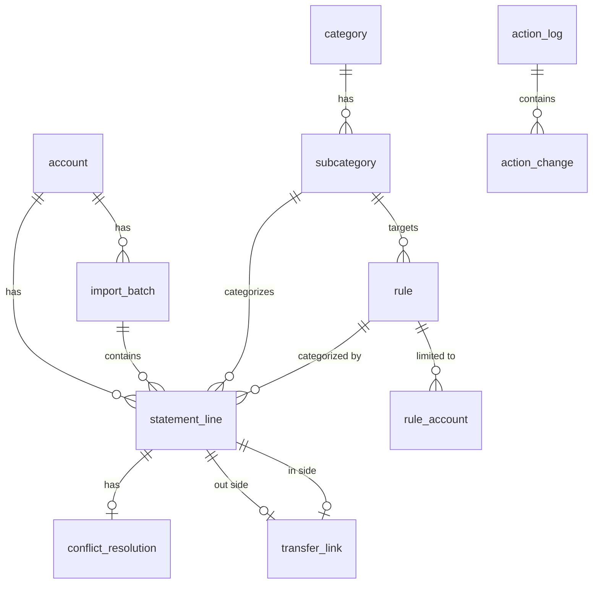

# FinanceAnalysis – Product Requirements Document

| | |
|---|---|
| Status | Draft v1 |
| Date | 2026-10-29 |
| Owner | FRLA |

## 1. Summary

FinanceAnalysis is a locally hosted web application that helps one person catalogue and visualize personal spending. The user exports statements from their online bank as CSV and imports them per account. Every line is stored in a SQLite database, categorized manually or by regex rules, linked to its counterpart when it is an internal transfer, and visualized in configurable charts.

The application is for **analysis of past spending**, not budgeting or planning.

## 2. Goals and non-goals

### Goals

- Import bank CSV files reliably, without duplicates, with the ability to undo the latest import.
- Categorize every line into one of four fixed top-level categories and a user-defined subcategory.
- Make bulk categorization fast via regex rules with server-side previews and diffs.
- Make manual categorization fast via a keyboard-first UI with undo.
- Detect internal transfers between the user's own accounts automatically.
- Allow filtering across ~5 years of statements.
- Provide charts with sensible defaults and useful filters.
- Run fully offline; the database is a single portable file.
- Work equally well on Linux and Windows.

### Non-goals (v1)

- Budgeting, planning or targets.
- Split transactions (a line has exactly one subcategory).
- Household / multi-user support, authentication.
- Credit card and loan accounts (loan payments are simply expenses).
- Multiple currencies.
- Text cleanup / normalization of bank messages (regex handles variation).
- Rule types other than regex (e.g. "contains", "starts with").
- Categorization suggestions based on history (planned for a late milestone).
- Any network traffic beyond localhost.

## 3. Glossary

| Term | Meaning |
|---|---|
| Line | One row from a bank statement (`statement_line`). |
| Account | A bank account the user imports statements for. |
| Category | One of the fixed top-level categories: Income, Fixed costs, Variable spending, Savings. |
| Subcategory | User-defined child of exactly one category, e.g. Groceries under Variable spending. |
| Rule | A regex (plus optional account and direction filters) that assigns a subcategory. |
| Source | How a line got its categorization: `none`, `rule`, `manual`, `transfer`, `conflict`. |
| Transfer | Two lines on different accounts, same date, equal and opposite amounts, linked as one internal movement. |
| Spread | Distributing a line's amount evenly over X months in charts. |
| Import | One uploaded file for one account (`import_batch`). |

## 4. Users and context

- Primary user: the owner/developer, technically proficient, comfortable writing regex.
- Later users: people who download and run the app locally on their own computer.
- Data volume: ~5 years, a handful of accounts, estimated 10,000–40,000 lines.
- All accounts initially belong to the same Danish bank.

## 5. Technology and architecture

### 5.1 Stack

| Layer | Choice | Rationale |
|---|---|---|
| Backend | Go (stdlib `net/http`, Go 1.22+ routing) | Single static binary, good learning project, no framework lock-in. |
| SQLite driver | `modernc.org/sqlite` | Pure Go, no CGO: identical build on Linux and Windows; supports custom SQL functions (e.g. `REGEXP`). |
| Query layer | `sqlc` | Type-safe Go generated from plain SQL. |
| Migrations | `goose`, SQL files embedded via `embed.FS` | Run automatically on startup. See section 9. |
| Frontend | Svelte 5 + SvelteKit (`adapter-static`, SPA mode) + Vite | Good fit for interactive categorization and chart pages. |
| Styling | Tailwind CSS v4 | Utility classes; easy iteration on the category color scheme. |
| Charts | Apache ECharts | Stacked/interactive charts, click events for drill-down. |
| i18n | Message catalog (e.g. Paraglide or svelte-i18n), English only in v1 | Prepared for translation later. |
| Task runner | `go-task` (Taskfile.yml) | Cross-platform; avoids `make` on Windows. |
| Tests | Go `testing`, Vitest, Playwright | See section 10. |

The built frontend is embedded in the Go binary, so the server serves both the JSON API (`/api/...`) and the SPA.

### 5.2 Distribution and runtime (Docker)

The primary distribution is a Docker image. The same Go binary can also run natively for development and tests.

- **Image:** multi-stage build (Node builds the frontend → Go builds the binary → minimal runtime image).
- **Run:**
  `docker run -p 127.0.0.1:8080:8080 -v ./data:/data financeanalysis`
  A `compose.yaml` with the same settings is provided.
- **Data directory:** a **bind-mounted host folder** (`./data` → `/data`), configured via the env var `FA_DATA_DIR` (default `/data` in the container, `./data` natively).
  - Database: `/data/finance.sqlite`
  - Backups: `/data/backups/`
- **Single-file database:** SQLite runs with `journal_mode=DELETE` (not WAL). There are no `-wal`/`-shm` sidecar files, so the database is always exactly one file. This also avoids WAL locking issues on Docker Desktop bind mounts on Windows. Concurrency needs are minimal (single user).
- **Extracting the database:**
  1. Copy `data/finance.sqlite` from the host folder while the app is stopped, or
  2. Use the **Download database** button, which produces a consistent snapshot via `VACUUM INTO` while running.
- **Testability:** the data directory is just a path. Go tests and Playwright tests run against temporary directories, with no Docker required.
- **Network:** the server makes no outbound requests. All assets (fonts, icons, JS) are bundled, with no CDN, telemetry or update checks. The port is published on `127.0.0.1` only.

### 5.3 Data conventions

- Amounts are stored as `INTEGER` minor units (øre). Floats are never used.
- Dates are stored as `TEXT` ISO `YYYY-MM-DD`; timestamps as ISO 8601 UTC.
- Foreign keys are enabled (`PRAGMA foreign_keys = ON`).
- Display locale for numbers/dates defaults to `da-DK` (e.g. `-1.357,97 kr.`), configurable in settings.

## 6. Data model

| Table | Key columns |
|---|---|
| `account` | `id`, `name` (unique), `account_number` (optional, reference only), `sort_order`, `archived`, `created_at` |
| `import_batch` | `id`, `account_id`, `file_name`, `file_sha256`, `imported_at`, `line_count`, `duplicate_count`, `undone_at` |
| `statement_line` | `id`, `account_id`, `import_id`, `booking_date`, `message`, `amount_minor`, `balance_minor`, `currency`, `file_row`, `seq` (chronological order within the import), `occurrence`, `subcategory_id` (nullable), `source` (`none`/`rule`/`manual`/`transfer`/`conflict`), `rule_id` (nullable), `spread_months` (default 1) |
| `category` | `id`, `key` (`income`, `fixed`, `variable`, `savings`), `name`, `color`. Seeded by migration; not user-creatable. |
| `subcategory` | `id`, `category_id`, `name` (unique per category), `color`, `icon` (nullable), `hotkey` (nullable, unique), `sort_order` |
| `rule` | `id`, `name`, `pattern`, `direction` (`in`/`out`/`both`), `subcategory_id`, `enabled`, `created_at`, `updated_at` |
| `rule_account` | `rule_id`, `account_id`. No rows means the rule applies to all accounts. |
| `conflict_resolution` | `line_id` (PK), `rule_id`. The user's remembered choice when several rules match. |
| `transfer_link` | `id`, `out_line_id` (unique), `in_line_id` (unique), `method` (`auto`/`manual`), `created_at` |
| `transfer_rejection` | `out_line_id`, `in_line_id`. Pairs the user unlinked; never auto-matched again. |
| `action_log` | `id`, `kind`, `description`, `created_at`, `undone_at`. One undoable user action. |
| `action_change` | `action_id`, `entity`, `entity_id`, `before_json`, `after_json`. Row-level before/after state. |
| `setting` | `key`, `value` |

Uniqueness of lines (duplicate detection) is enforced by a unique index on `(account_id, booking_date, amount_minor, balance_minor, message, occurrence)`. `occurrence` is the 1-based index among identical tuples within a file and only matters for edge cases such as zero-amount lines.

## 7. Functional requirements

Requirement IDs are used for tracking. **Must** = v1, **Should** = v1 if feasible, **Later** = after v1.

### 7.1 Welcome and setup (SETUP)

| ID | Priority | Requirement |
|---|---|---|
| SETUP-1 | Must | On start, if `finance.sqlite` does not exist in the data directory, show the welcome page. Otherwise go to the dashboard. |
| SETUP-2 | Must | Welcome page offers **Create new database** and **Upload existing database**. |
| SETUP-3 | Must | Create new: a wizard to (1) add one or more accounts, (2) review a seeded, editable list of default subcategories per category, (3) finish and go to Upload. |
| SETUP-4 | Must | Upload existing: validate that the file is a SQLite database with this app's schema. If the schema is older, back it up and migrate. If it is newer than the app supports, refuse with a clear message. |
| SETUP-5 | Must | Settings page: manage accounts, subcategories (name, color, hotkey, order), display locale, **Download database**, **Replace database** (with automatic backup), and list/restore backups. |
| SETUP-6 | Must | Accounts can be renamed and archived. An account can only be deleted if it has no lines. |

### 7.2 Import (IMP)

**Bank CSV format (initial bank):**

- UTF-8 with BOM, no header row, `;` separated.
- Columns: `date;message;amount;running balance;currency`
- Example: `02-05-2025;KREDSLøB A/S Aftalenr. 993695201;-1.357,97;47.911,77;DKK`
- Date `dd-mm-yyyy`. Amounts use `.` as thousands separator and `,` as decimal separator.
- Rows are ordered **newest first**. Chronological order within a day is therefore the reverse of file order.
- The bank never changes the message of a booked line, so the duplicate key (section 6) is stable across overlapping exports.

| ID | Priority | Requirement |
|---|---|---|
| IMP-1 | Must | The user selects one file and the target account, then uploads. |
| IMP-2 | Must | The parser strips the BOM and handles standard CSV quoting. To tolerate `;` inside messages, it reads the first field as date, the last three as amount/balance/currency, and joins everything in between as the message. |
| IMP-3 | Must | Rows that fail parsing are reported with row number and reason. |
| IMP-4 | Must | Rows with a currency other than `DKK` are reported and excluded. |
| IMP-5 | Must | **Preview step** before committing shows: date range, number of new lines, number of duplicates (already imported), parse errors, and warnings. Nothing is written until the user confirms. |
| IMP-6 | Must | Duplicate lines (same unique key, see section 6) are skipped, so overlapping exports are safe. |
| IMP-7 | Must | Balance continuity check: for each row and the row below it (the previous transaction), `balance(row) = balance(row below) + amount(row)`. Gaps are shown as warnings. |
| IMP-8 | Must | Account sanity check: if the file's balances do not connect to the existing lines of the selected account (the oldest new row's `balance - amount` should equal the balance of the latest existing line before it, and likewise at the newest end), warn "This file may belong to a different account". |
| IMP-8a | Must | Lines are stored with a chronological sequence (reverse of file order), so lines on the same day sort and display in the order they were booked. |
| IMP-9 | Must | Re-uploading a file with an identical SHA-256 to a previous import shows a warning. |
| IMP-10 | Must | A database backup is taken automatically before commit. |
| IMP-11 | Must | On commit, run transfer detection (7.4), then rule evaluation (7.5) for the new lines. |
| IMP-12 | Must | Result screen shows: lines imported, auto-categorized by rules, matched as transfers, ambiguous transfer candidates, rule conflicts, and **uncategorized**, with a button to categorize them now. |
| IMP-13 | Must | **Undo import**: only the most recent non-undone import (globally, as a stack) can be undone, after confirmation. It deletes the import's lines, their transfer links (the counterpart line is re-evaluated) and conflict resolutions, plus action log entries referencing those lines. A backup is taken first. |
| IMP-14 | Must | An import history page lists all imports with account, file name, date range, counts and status. |
| IMP-15 | Later | Import profiles for other banks / formats. |

### 7.3 Categories (CAT)

| ID | Priority | Requirement |
|---|---|---|
| CAT-1 | Must | Fixed categories: **Income**, **Fixed costs** (housing loan, insurance, subscriptions, …), **Variable spending** (groceries, second hand, …), **Savings**. |
| CAT-2 | Must | System states that are not categories: **Transfer** (linked internal transfer, excluded from charts) and **Uncategorized**. |
| CAT-3 | Must | Subcategories are user-defined under exactly one category. They can be created, renamed, reordered, recolored and moved to another category. |
| CAT-4 | Must | Deleting a subcategory that is in use requires choosing a target subcategory to merge into. Lines and rules pointing to it are reassigned. This is undoable. |
| CAT-5 | Must | Colors: each category has a base hue. Subcategories get auto-generated shades of that hue, overridable per subcategory. Transfer is grey; Uncategorized is neutral. |
| CAT-6 | Should | Optional icon per subcategory from a bundled icon set. |
| CAT-7 | Must | Refunds are not special: the user puts them in the same subcategory as the original purchase so they net out. |
| CAT-8 | Must | Transfers to external accounts (other people) are ordinary lines and categorized like any expense. |

### 7.4 Transfer detection (TRF)

| ID | Priority | Requirement |
|---|---|---|
| TRF-1 | Must | Candidate pair: two lines on **different accounts**, **same booking date**, `amount_out = -amount_in`, neither already linked, and the pair not in `transfer_rejection`. |
| TRF-2 | Must | If a line has exactly one candidate, and that candidate has exactly one candidate (unique 1:1), link them automatically (`method = auto`). |
| TRF-3 | Must | Ambiguous candidates (several possible counterparts) are not linked. They are listed in a **Transfer review** view where the user picks the correct pair or dismisses them. |
| TRF-4 | Must | Detection runs over all data after every import, since the counterpart account may be imported later. |
| TRF-5 | Must | Linked lines get `source = transfer` and are excluded from charts. |
| TRF-6 | Must | The user can **unlink** a pair. The pair is recorded in `transfer_rejection` and both lines are re-evaluated by rules. Undoable. |
| TRF-7 | Must | The user can manually link two lines (different accounts, equal and opposite amounts; any date). |
| TRF-8 | Must | The user can manually recategorize either side of a linked pair (e.g. the outgoing side to Savings). That side becomes `source = manual`; the link remains and is still shown. |
| TRF-9 | Must | The statements view shows the link and lets the user jump to the counterpart line. |

### 7.5 Rules (RULE)

**Rule definition:** Go RE2 regex `pattern` matched against `message`, **case-sensitive** (the user writes `(?i)` when needed). Optional filters: a set of accounts (empty = all) and a direction (`in` = amount > 0, `out` = amount < 0, `both`). Target: one subcategory.

**Evaluation precedence for a line:**

1. `manual` → never touched by rules.
2. `transfer` → never touched by rules.
3. Find all enabled matching rules:
   - 0 matches → `none` (uncategorized).
   - 1 match → `rule`, with that rule's subcategory.
   - More than 1 match → if a `conflict_resolution` exists and its rule is still among the matches, use it. Otherwise `conflict` (uncategorized and flagged).

| ID | Priority | Requirement |
|---|---|---|
| RULE-1 | Must | Create a rule from scratch, or from a focused line ("Create rule from this line"), which prefills the pattern with the escaped message, the line's account and direction. |
| RULE-2 | Must | Invalid regex is reported with the compiler error before saving. |
| RULE-3 | Must | **Live preview (server-side)** while editing shows the matching lines grouped by effect: *will be categorized* (currently uncategorized), *already this rule*, *will conflict* (matched by another rule), *unaffected: manual*, *unaffected: transfer*. Counts are shown per group. |
| RULE-4 | Must | **Edit diff:** editing an existing rule shows lines **added**, **removed** and **unchanged** relative to the current version. For removed lines, it shows what they will become (other rule, conflict or uncategorized). |
| RULE-5 | Must | Saving applies changes atomically and is recorded as one undoable action (rule definition + all affected lines). |
| RULE-6 | Must | Lines dropped by an edited, disabled or deleted rule are re-evaluated (another rule, conflict or uncategorized). |
| RULE-7 | Must | **Conflicts:** a conflict list shows each conflicting line with the matching rules. The user picks the winning rule (remembered in `conflict_resolution`) or categorizes the line manually. Each matching rule has an **Edit rule** link. |
| RULE-8 | Must | Rules page lists all rules with pattern, filters, target, enabled state and match count, and is sortable and filterable. |
| RULE-9 | Must | A remembered conflict resolution is dropped automatically if its chosen rule no longer matches the line. |
| RULE-10 | Later | Additional rule types ("contains", "starts with"), amount-range conditions. |

### 7.6 Categorization page (CATZ)

The main workspace for categorizing lines quickly.

| ID | Priority | Requirement |
|---|---|---|
| CATZ-1 | Must | Shows a list of lines. The default filter is *uncategorized + conflicts*, newest first. The same filters as the statements view are available. |
| CATZ-2 | Must | One line is focused (clearly highlighted). The focused line's details (account, full message, amount, balance, current source) are always visible. |
| CATZ-3 | Must | A subcategory palette grouped by category, colored by category hue, with each subcategory's hotkey shown on its button. |
| CATZ-4 | Must | Pressing a subcategory hotkey or clicking a subcategory assigns it to the focused line (`source = manual`) and moves focus to the next line in the list. Categorized lines stay visible (dimmed) until the list is refreshed, so context is kept. |
| CATZ-5 | Must | A type-ahead subcategory picker (fuzzy search) for when there are too many subcategories for hotkeys. |
| CATZ-6 | Must | Undo (`Ctrl+Z`) reverts the most recent action, and focus returns to the affected line. Redo (`Ctrl+Shift+Z`) is a **Should**. |
| CATZ-7 | Must | Actions on the focused line: create rule from line, set spread months, reset to rules (clear manual), resolve conflict, jump to transfer counterpart. |
| CATZ-8 | Must | Shortcut discovery: hotkey badges on buttons, a persistent hint bar, and `?` opens a full shortcut overlay. |
| CATZ-9 | Must | Proposed default shortcuts (to be iterated): `↑/↓` or `k/j` move focus; subcategory hotkeys assign; `Space` opens the picker; `r` creates a rule from the line; `s` sets spread; `Backspace` resets to rules; `Ctrl+Z` undoes; `/` focuses the filter; `?` shows help. |
| CATZ-10 | Must | Hotkeys are user-assignable per subcategory (single character, unique, cannot collide with reserved keys). |
| CATZ-11 | Should | Multi-select (`Shift+↑/↓`) to assign one subcategory to several lines at once. |

### 7.7 Undo (UNDO)

| ID | Priority | Requirement |
|---|---|---|
| UNDO-1 | Must | Undoable actions: manual categorization, reset to rules, conflict resolution, rule create/edit/enable/disable/delete (including affected lines), transfer link/unlink, spread change, subcategory merge-delete. |
| UNDO-2 | Must | Each action stores before/after state of every affected row in `action_log`/`action_change`, so undo works across page reloads and restarts. |
| UNDO-3 | Must | Undo is strictly LIFO. The app keeps at least the last 200 actions. |
| UNDO-4 | Must | Imports are not part of this stack; they have their own undo (IMP-13). |
| UNDO-5 | Should | An action history panel lists recent actions with descriptions. |

### 7.8 Statements view (STMT)

A read-only, raw view of all lines.

| ID | Priority | Requirement |
|---|---|---|
| STMT-1 | Must | Table columns: date, account, message, amount, balance, category, subcategory, source (with link to the rule if `rule`), transfer link, spread. |
| STMT-2 | Must | Filters: date range (with presets), accounts, direction, amount range, message text (substring or regex, evaluated server-side), categories, subcategories, source (`none`/`rule`/`manual`/`transfer`/`conflict`), specific rule, import batch, spread > 1. |
| STMT-3 | Must | Server-side filtering, sorting and pagination. Typical queries respond in under 200 ms at 40,000 lines. |
| STMT-4 | Must | Totals for the filtered set: sum in, sum out, net, count. |
| STMT-5 | Must | Filter state is encoded in the URL (bookmarkable; back/forward works). |
| STMT-6 | Must | **Categorize these** opens the categorization page with the same filter. Each row links to the categorization page focused on that line. |

### 7.9 Visualization (VIZ)

**Metric definitions:**

- Lines with `source = transfer` are excluded by default (toggleable).
- Category totals are **net sums** of lines in the category, so refunds offset purchases. Expense categories are displayed as positive magnitudes.
- **Spread:** a line with `spread_months = X` contributes `amount / X` to its payment month and each of the next X−1 months. Rounding remainder (øre) goes to the first month.
- Months are calendar months.
- Uncategorized and conflict lines appear as their own series, so gaps in categorization are visible.

| ID | Priority | Requirement |
|---|---|---|
| VIZ-1 | Must | Default dashboard charts: (a) monthly stacked bars of Fixed costs, Variable spending and Savings with Income as a line; (b) income vs. expenses vs. savings per month with savings rate; (c) subcategory breakdown over time for a selected category; (d) subcategory share for the selected period (donut/treemap); (e) rolling X-month average per category/subcategory; (f) per-account average monthly spending over the last X months. |
| VIZ-2 | Must | Global filters: date range (presets: last 12 months, year to date, previous year, all, custom), accounts, categories, subcategories, granularity (month/quarter/year), include transfers, averaging window X. |
| VIZ-3 | Must | Per-chart options (chart type where meaningful, series selection, stacked vs. grouped) with sensible defaults. Configuration is persisted in `setting`. |
| VIZ-4 | Must | Clicking a chart segment opens the statements view filtered to exactly the lines behind it. |
| VIZ-5 | Must | Filter state is encoded in the URL. |
| VIZ-6 | Must | Category/subcategory colors from CAT-5 are used consistently. |
| VIZ-7 | Must | Spread is set per line (1–36 months) from the categorization page. |
| VIZ-8 | Later | Multiple saved dashboards / named views. |

## 8. Non-functional requirements

| ID | Requirement |
|---|---|
| NFR-1 | **Offline:** zero outbound network traffic. All assets bundled. |
| NFR-2 | **Cross-platform:** builds, runs and tests identically on Linux and Windows (Docker and native). No CGO. Tasks via Taskfile. |
| NFR-3 | **Performance:** page interactions under 200 ms at 40,000 lines; import of a 5-year file (~10,000 lines) under 5 seconds including rule evaluation. |
| NFR-4 | **Data safety:** automatic backups before import, import undo, database replace and migrations. Keeps the last 20 backups. All multi-row changes run in transactions. |
| NFR-5 | **Portability:** the database is one self-contained SQLite file usable with any SQLite tool. |
| NFR-6 | **Accessibility:** full keyboard operation of categorization; colors are never the only carrier of meaning (labels always present); contrast checked. |
| NFR-7 | **i18n-ready:** all UI strings in a message catalog; numbers/dates formatted via `Intl` with a configurable locale. |
| NFR-8 | **Security (minimal):** server listens only where published (`127.0.0.1`); uploads are size-limited; SQL only via parameterized queries; regex evaluated with RE2 (linear time, no catastrophic backtracking). |

## 9. Database migrations

### 9.1 Mechanism

- `goose` with **sequentially numbered** SQL files (`00001_init.sql`, `00002_add_spread.sql`, …), embedded in the binary.
- On startup: if pending migrations exist, take a backup, then apply them in a transaction. If the database schema version is newer than the binary supports, refuse to start with a clear error.
- `sqlc` code is regenerated after every schema change; CI fails if the generated code is out of date.
- Each milestone adds only the tables it needs, via new migrations. The schema in section 6 is the v1 target, not a single initial migration.

### 9.2 Migration guide (deliverable: `docs/migrations.md`)

A written guide is a required deliverable. It must cover at least:

1. **One logical change per migration**, with a descriptive file name.
2. **Never edit a migration that has been released or applied to a real database.** Fix forward with a new migration.
3. **Forward-only in practice.** Down migrations are written for local development but not relied on for user data. Backups are the rollback strategy.
4. **SQLite `ALTER TABLE` limitations** and the official 12-step table rebuild procedure: disable foreign keys, create the new table, copy data, drop the old one, rename, recreate indexes/triggers/views, run `PRAGMA foreign_key_check`, re-enable foreign keys. Include a template.
5. **Separate schema changes from data backfills** where practical. Backfills must be idempotent.
6. **Seeded/reference data** (e.g. `category` rows) is changed only via migrations.
7. **Testing every migration:**
   - migrate up from an empty database;
   - migrate up from a fixture database of the previous release (fixture DBs are kept in the repo);
   - check `PRAGMA integrity_check` and `PRAGMA foreign_key_check` afterwards.
8. **Checklist** for a schema change: migration file → `sqlc generate` → update Go code → update fixtures/tests → update the data model table in this PRD.

## 10. Testing strategy

- **Go unit tests:** CSV parsing (BOM, number formats, `;` in message, errors), duplicate detection, balance continuity, transfer matching (unique, ambiguous, rejected pairs), rule evaluation precedence and conflicts, rule diffs, spread calculation, undo/redo of each action kind.
- **Go integration tests:** HTTP API against a real SQLite file in a temp directory.
- **Migration tests:** as in 9.2 item 7.
- **Frontend:** Vitest for components and logic; Playwright end-to-end for the core flows (setup → import → categorize with keyboard → undo → rule with preview → charts drill-down), run against the native binary with a temp data directory.
- **Fixtures:** anonymized sample CSV files covering all edge cases.

## 11. Milestones

| # | Milestone | Content |
|---|---|---|
| M0 | Skeleton | Repo layout, Go server + embedded Svelte SPA, SQLite + goose + sqlc, Taskfile, Dockerfile/compose, CI, migration guide. |
| M1 | Data in | Welcome/setup, accounts, subcategories, import with preview/dedup/checks, import undo, import history, statements view. |
| M2 | Manual categorization | Categorization page, hotkeys, picker, undo log, spread. |
| M3 | Rules | Rule CRUD, live preview, edit diff, conflicts, re-evaluation. |
| M4 | Transfers | Auto detection, transfer review, manual link/unlink. |
| M5 | Visualization | Default dashboard, filters, drill-down, spread in charts. |
| M6 | Polish | Colors/icons iteration, shortcut overlay, action history, i18n extraction, performance pass. |
| Later | Extensions | Categorization suggestions, other rule types, other bank formats, saved dashboards, native binaries for download. |

## 12. Open questions and risks

| # | Topic | Notes |
|---|---|---|
| 1 | Hotkey scalability | Single-character hotkeys may run out with many subcategories; the picker is the fallback. Iterate in M2. |
| 2 | Color scheme | Shades per hue become hard to distinguish beyond ~6 subcategories. Iterate in M6. |
| 3 | Docker Desktop on Windows | Bind-mount I/O is slower; acceptable at this data volume. `journal_mode=DELETE` avoids WAL locking issues. |
| 4 | Same-day-only transfer matching | Sufficient for a single bank. Revisit (± N days) when other banks are supported. |
